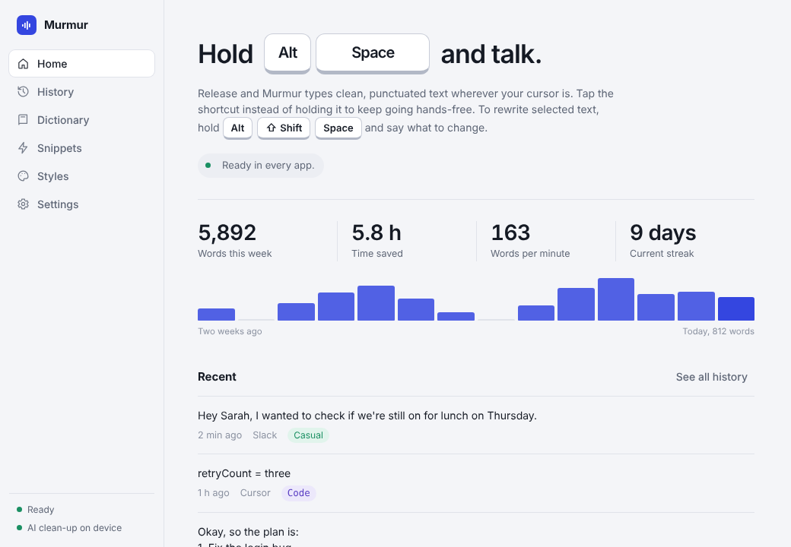

# Murmur

**Free, private AI voice dictation for every app.** Hold a shortcut, talk, and Murmur types clean, punctuated text wherever your cursor is — Slack, Gmail, Word, VS Code, your terminal, anything.



Speech recognition runs on your own computer with [whisper.cpp](https://github.com/ggerganov/whisper.cpp). There's no account, no subscription, no word limit and no telemetry.

| | Wispr Flow | Murmur |
|---|---|---|
| Price | Free tier, Pro $12–15/month | Free, unlimited |
| Where your voice goes | Cloud servers | Stays on your computer by default |
| Account required | Yes | No |
| Works offline | No | Yes |
| Filler removal, self-corrections, auto-punctuation | ✓ | ✓ |
| Command mode (edit selected text by voice) | ✓ | ✓ (needs a local or cloud AI model) |
| Personal dictionary & snippets | ✓ | ✓ |
| Per-app tone | ✓ | ✓, plus your own rules |
| Whisper mode (quiet speech) | ✓ | ✓ |
| Built-in code dictation (camelCase, symbols) | | ✓ |
| Local HTTP API for your own scripts | | ✓ |
| Open source | – | ✓ MIT |
| Platforms | Mac, Windows, iOS, Android | Mac, Windows, Linux |

## How it works

1. **Hold** your shortcut (default <kbd>Alt</kbd>+<kbd>Space</kbd>, <kbd>⌥ Option</kbd>+<kbd>Space</kbd> on Mac) and speak. A small listening bar shows a live waveform. <kbd>Esc</kbd> cancels.
2. **Release.** Murmur trims silence, transcribes on-device, cleans up the text and pastes it at your cursor. Your clipboard is restored afterwards.
3. **Tap** the shortcut instead of holding it to go hands-free; tap again to finish.
4. **Command mode:** select some text, hold <kbd>Alt</kbd>+<kbd>Shift</kbd>+<kbd>Space</kbd> and say *"make this friendlier"*, *"translate to Spanish"* or *"turn this into bullet points"*. With nothing selected, it writes new text: *"write a polite reply declining the meeting"*.

### What the clean-up does

Every dictation goes through Murmur's built-in rule engine (instant, always on device):

- Removes fillers: *um, uh, er, "you know,", ", like,"*
- Resolves self-corrections: *"meet at 5, no wait, 6"* → *"meet at 6"*; *"scratch that"* deletes the previous sentence
- Formats spoken lists: *"first… second… third…"* → a numbered list
- Voice commands: *"new line"*, *"new paragraph"*, *"question mark"* (and optionally *"comma"*, *"period"*)
- Capitalization, sentence punctuation, your dictionary spellings and snippets
- **Code style** in editors and terminals: *"camel case user id equals five"* → `userId = five`, *"npm run dev dash dash port 3000"* → `npm run dev --port 3000`

If a language model is available, it adds a second pass for smarter punctuation and phrasing. Murmur checks the model's answer and falls back to the rule engine if the model tried to answer a question or ramble instead of cleaning up.

## Install

Download the installer for your computer from the **Releases** page of this repository.

| Computer | File |
|---|---|
| Mac with Apple Silicon (M1–M4) | `Murmur_x.y.z_aarch64.dmg` |
| Mac with Intel | `Murmur_x.y.z_x64.dmg` |
| Windows 10/11 | `Murmur_x.y.z_x64-setup.exe` |
| Linux | `.AppImage` (any distro), `.deb` (Ubuntu/Debian) or `.rpm` (Fedora) |

The builds aren't code-signed (signing costs money every year), so your OS will warn you once:

- **Mac:** drag Murmur to Applications, then right-click it → **Open** → **Open**. If macOS says the app "is damaged", run `xattr -cr /Applications/Murmur.app` in Terminal once. Then allow **Microphone** and **Accessibility** when asked (System Settings → Privacy & Security). Accessibility is what lets Murmur paste into other apps.
- **Windows:** if SmartScreen appears, click **More info** → **Run anyway**.
- **Linux:** `chmod +x Murmur_*.AppImage` and run it. Global shortcuts need an X11 session; on Wayland, start dictation from the tray menu or bind a desktop shortcut to it.

On first launch Murmur walks you through permissions, your shortcut, downloading a speech model (142 MB for the recommended one) and a practice dictation.

## Optional: smarter clean-up with a free local AI model

1. Install [Ollama](https://ollama.com/download) (free).
2. In Murmur → Settings → AI clean-up, click **Download qwen2.5:3b** (about 2 GB), or run `ollama pull qwen2.5:3b`.

That's it — "Automatic" mode uses Ollama whenever it's running and falls back to the rule engine when it isn't. Everything still stays on your computer.

Prefer the cloud? Choose **OpenAI-compatible** (OpenAI, Groq, OpenRouter, or a local LM Studio server) or **Anthropic** and paste an API key. Murmur shows a warning while your text is leaving your machine.

### Picking a speech model

| Model | Download | Best for |
|---|---|---|
| Base (English) | 142 MB | Most English speakers. Fast on any laptop from the last ~6 years. |
| Base (multilingual) | 142 MB | Other languages and mixed speech like Taglish or Hinglish. |
| Small | 466 MB | Better with names and jargon. |
| Large v3 Turbo (compressed) | 547 MB | Near-best accuracy. Great on Apple Silicon or a GPU. |
| Large v3 Turbo | 1.6 GB | Maximum accuracy on strong machines. |

Apple Silicon Macs use the GPU (Metal) automatically. On Windows/Linux with an NVIDIA GPU, build with `--features cuda` (see below) for a big speed-up on larger models.

## Build the installers yourself (no coding needed)

The repository includes a GitHub Actions workflow that builds every installer for you on GitHub's servers, for free:

1. Create a free account at [github.com](https://github.com) and click **New repository** (public repositories get free build minutes).
2. Upload this project's files (drag the unzipped folder contents onto the repository page, or use `git push`). Make sure the hidden `.github` folder is included.
3. Open the **Actions** tab, choose **Build installers**, and click **Run workflow**.
4. After ~15–25 minutes, open **Releases**: a draft release contains the `.dmg`, `.exe`, `.msi`, `.AppImage`, `.deb` and `.rpm` files. Click **Edit → Publish release** to make the download links public.

To publish a new version later, bump `version` in `src-tauri/tauri.conf.json` and run the workflow again (or push a tag like `v0.2.0`).

## Build from source

Requirements: [Rust](https://rustup.rs), Node.js 20+, CMake, and a C/C++ compiler with Clang (for whisper.cpp).

- **macOS:** `xcode-select --install` and `brew install cmake`
- **Windows:** Visual Studio Build Tools (C++ workload), [CMake](https://cmake.org/download/) and [LLVM](https://github.com/llvm/llvm-project/releases); set `LIBCLANG_PATH=C:\Program Files\LLVM\bin`
- **Ubuntu/Debian:**
  ```sh
  sudo apt install libwebkit2gtk-4.1-dev libappindicator3-dev librsvg2-dev patchelf \
    libasound2-dev libxdo-dev libclang-dev cmake build-essential libgtk-3-dev
  ```

Then:

```sh
npm install
npm run tauri dev          # run with hot reload
npm run tauri build        # make installers in src-tauri/target/release/bundle
npm run tauri build -- --features cuda   # NVIDIA GPU acceleration (needs the CUDA toolkit)
```

Just working on the interface? `npm run dev` and open http://localhost:1420 in a browser. A built-in mock backend fills in sample data; hold <kbd>Alt</kbd>+<kbd>Space</kbd> to simulate a dictation.

### Tests

```sh
cargo test --manifest-path src-tauri/Cargo.toml      # everything
rustc --edition 2021 --test src-tauri/src/text.rs -o /tmp/t && /tmp/t   # clean-up engine only, no deps
npm run eval:cleanup -- qwen2.5:3b                    # score an Ollama model on sample transcripts
```

## Local API

Turn it on in Settings → Developers. It only listens on `127.0.0.1`.

```sh
# Transcribe and clean a WAV file
curl -X POST --data-binary @note.wav "http://127.0.0.1:7071/v1/transcribe?style=formal"
# => {"raw": "um so ...", "text": "So ..."}

# Clean up text you already have
curl -X POST -d '{"text":"um so yeah lets ship it","style":"casual"}' http://127.0.0.1:7071/v1/clean

curl http://127.0.0.1:7071/v1/health
```

Styles: `neutral`, `casual`, `formal`, `code`. Add `clean=0` to `/v1/transcribe` for the raw transcript.

## Privacy

- The microphone is only open while your shortcut is active (or hands-free mode is on). Audio lives in memory and is discarded right after transcription; it is never written to disk.
- Murmur never logs keystrokes. It simulates exactly two key combinations: paste, and copy (only in command mode, to read your selection).
- History, dictionary, snippets, stats and settings live in a single folder on your computer (Settings → Privacy → Open). You can turn history off, auto-delete it after a few days, or erase everything with one click.
- The only network requests Murmur makes on its own are model downloads from Hugging Face, and calls to the AI provider you chose (localhost for Ollama).

## Project layout

```
src-tauri/src/
  main.rs        app setup, tray, overlay window
  dictation.rs   hotkey events → record → transcribe → clean → insert
  text.rs        rule-based clean-up engine, LLM prompts and output checks (unit-tested)
  dsp.rs         resampling, silence trimming, gain (unit-tested)
  audio.rs       microphone capture (cpal)
  stt.rs         whisper.cpp transcription
  llm.rs         Ollama / OpenAI-compatible / Anthropic clients
  insert.rs      paste into the focused app, read the selection
  hotkeys.rs     global shortcuts
  db.rs          SQLite: history, dictionary, snippets, stats
  models.rs      speech model catalog and downloader
  api.rs         local HTTP API
  prompts/       the clean-up and command prompts
src/             React interface (main window + overlay.tsx listening bar)
```

## Known limitations

- **Wayland (Linux):** apps can't register global shortcuts. Use the tray menu or an X11 session.
- **Paste-based insertion:** a few apps that block pasting (some password fields, remote desktops) won't receive text; Murmur leaves it on your clipboard and tells you.
- **Command mode** needs an AI model (Ollama works). The rule engine alone can't rewrite text.
- **No mobile apps** yet.

## License

MIT. Speech recognition by [whisper.cpp](https://github.com/ggerganov/whisper.cpp) (MIT) using OpenAI's Whisper models (MIT).
